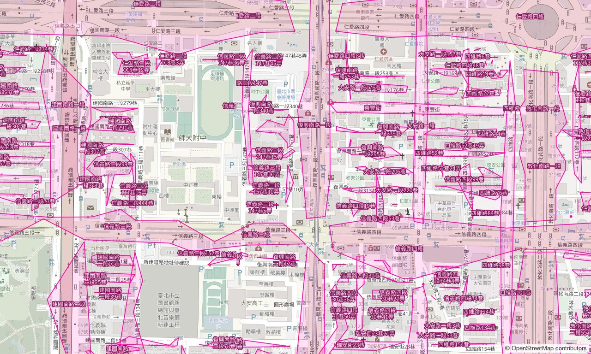

# Address Cluster Map of Taiwan

This project generates an address cluster map from the addresses imported into OpenStreetMap
from local government open data, serving as a utility for mappers to check and map
road and alley names in Taiwan.



## How to use

### Generate PMTiles from an OSM extract

Docker (with Docker Compose) is required.

First, get `taiwan-latest.osm.pbf` from [Geofabrik Download Server](https://download.geofabrik.de/asia/taiwan.html)
and put it in `source/`.
Geofabrik now uses `taiwan-YYMMDD.osm.pbf` as the default filename, so set `PBF` if needed,
e.g. `PBF=taiwan-261022.osm.pbf docker compose run importer`.

Then run the `importer` to import addresses into PostgreSQL and build the clusters,
and the `converter` to use GDAL to generate PMTiles:

```sh
docker compose run importer
docker compose run converter
```

As of October 2026 (`taiwan-261022.osm.pbf`), the `importer` took about 190 seconds and the `converter` took about 105 seconds
on my Ryzen 5 5600G machine running WSL 2.
The `addresses` table will have 9,711,502 entries on 5,184,341 distinct positions, generating 235,879 address clusters;
the generated PMTiles file is 45 MB.

### Serve raster tiles

After `source/cluster.pmtiles` is generated, start Tileserver GL:

```sh
docker compose up -d tileserver
```

It renders raster tiles on demand at `http://localhost:8886/`.
Traditional Chinese glyphs are built from Noto Sans CJK TC when building the image.

To use it in JOSM, add a TMS imagery layer with this URL:

```text
tms[11,19]:http://localhost:8886/styles/address-clusters/{zoom}/{x}/{y}.png
```

Tileserver GL renders 256px tiles with the map one zoom level lower,
so z11 is the lowest zoom with content.

## Design

### Architecture

The pipeline is a set of Docker Compose services sharing the `source/` directory:

```text
OSM extract (.pbf) ──importer──▶ PostGIS ──converter──▶ cluster.pmtiles ──tileserver──▶ raster tiles (JOSM)
```

* `postgis`: PostgreSQL with PostGIS, holding the imported addresses and the clusters.
  It is started automatically by the `importer` and `converter`.
* `importer`: [osm2pgsql](https://osm2pgsql.org/) loads address nodes into the `addresses` table
  with a flex style ([importer/addresses.lua](importer/addresses.lua)).
  Only nodes with `addr:city` and a source tag (`addr:TW:dataset` or `source:url`) are kept,
  which selects the open data imports.
  Then [importer/cluster.sql](importer/cluster.sql) builds the `address_clusters` materialized view.
* `converter`: GDAL's `ogr2ogr` exports `address_clusters` as vector tiles (z10–z15)
  into `source/cluster.pmtiles`.
* `tileserver`: [Tileserver GL](https://github.com/maptiler/tileserver-gl) renders the PMTiles
  into raster tiles with the style in [tileserver/styles/](tileserver/styles/),
  for editors that cannot display vector tiles.

### How clusters are made

* Addresses are grouped by city, district and `addr:street` (or `addr:place` when there is no street).
  Spelling variants like 台/臺 are folded together.
* Floors and units on the same position are counted once.
* Positions within 200m are clustered with DBSCAN. A lone position is kept as a point,
  unless the same address also exists elsewhere, which makes it a likely stray.
* Clusters longer than 1.5km are split into ~1km pieces with k-means,
  and drawn as concave hulls.
