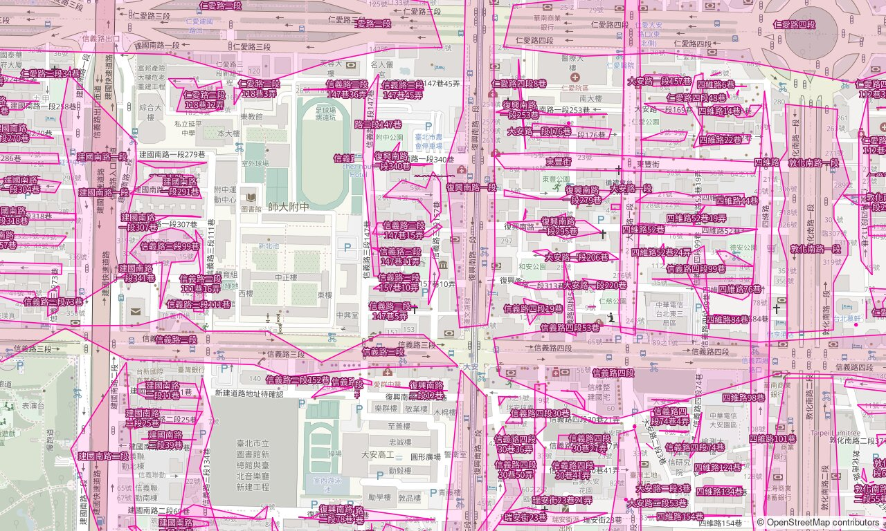

# Address Cluster Map of Taiwan

This project generates an address cluster map from the addresses imported into OpenStreetMap
from local government open data, serving as a utility for mappers to check and map
road and alley names in Taiwan.



## How to use

### Serve raster tiles

Docker is required. Start the tile server with the latest data:

```sh
docker run --rm -p 127.0.0.1:8886:8080 ghcr.io/osmhacktw/address-clusters
```

It renders raster tiles on demand at `http://localhost:8886/`.
To use it in JOSM, add a TMS imagery layer with this URL:

```text
tms[11,19]:http://localhost:8886/styles/address-clusters/{zoom}/{x}/{y}.png
```

Tileserver GL renders 256px tiles with the map one zoom level lower,
so z11 is the lowest zoom with content.

The image is tagged with the date of the OSM extract, e.g. `ghcr.io/osmhacktw/address-clusters:2026-11-11`.
The PMTiles files are also available from [Releases](https://github.com/OsmHackTW/address-clusters/releases).
To serve your own `cluster.pmtiles`, mount its directory at `/source`:

```sh
docker run --rm -p 127.0.0.1:8886:8080 -v ./source:/source:ro ghcr.io/osmhacktw/address-clusters
```

When changing the style, build the image locally with `docker build -t address-clusters tileserver/`
and run `address-clusters` in place of the image above.

### Generate PMTiles from an OSM extract

Docker (with Docker Compose) is required.

First, get the Taiwan extract from [Geofabrik Download Server](https://download.geofabrik.de/asia/taiwan.html)
and put it in `source/`.
The download is named `taiwan-YYMMDD.osm.pbf`, so set `PBF` to its filename
(the default is `taiwan-latest.osm.pbf`), then run the `importer` to import addresses into PostgreSQL
and build the clusters, and the `converter` to use GDAL to generate `source/cluster.pmtiles`:

```sh
export PBF=taiwan-261111.osm.pbf
docker compose run --rm importer
docker compose run --rm converter
```

As of October 2026 (`taiwan-261022.osm.pbf`), the `importer` took about 190 seconds and the `converter` took about 105 seconds
on my Ryzen 5 5600G machine running WSL 2.
The `addresses` table will have 9,711,502 entries on 5,184,341 distinct positions, generating 235,879 address clusters;
the generated PMTiles file is 45 MB.

### Releases

The [Build tiles](.github/workflows/build-tiles.yml) workflow is run manually,
from the Actions tab or with `gh workflow run build-tiles.yml`.
It downloads the latest Taiwan extract from Geofabrik, generates the PMTiles,
publishes them as a release tagged with the extract date,
and builds the tile server image with the PMTiles bundled
([tileserver-image.yml](.github/workflows/tileserver-image.yml)).
The image workflow can also be run alone to rebuild the image for an existing release,
e.g. after changing the style.

## Design

### Architecture

The pipeline is a set of Docker Compose services sharing the `source/` directory,
and the tile server is a separate image:

```text
OSM extract (.pbf) ──importer──▶ PostGIS ──converter──▶ cluster.pmtiles ──tileserver──▶ raster tiles (JOSM)
```

* `postgis`: PostgreSQL with PostGIS, holding the imported addresses and the clusters.
  It is started automatically by the `importer` and `converter`.
* `importer`: [osm2pgsql](https://osm2pgsql.org/) loads address nodes into the `addresses` table
  with a flex style ([importer/addresses.lua](importer/addresses.lua)).
  Only nodes with `addr:city` and a source tag (`addr:TW:dataset` or `source:url`) are kept,
  which selects the open data imports.
  Then [importer/cluster.sql](importer/cluster.sql) builds the `address_clusters` materialized view.
* `converter`: GDAL's `ogr2ogr` exports `address_clusters` as vector tiles (z10–z15)
  into `source/cluster.pmtiles`.
* [tileserver/](tileserver/): [Tileserver GL](https://github.com/maptiler/tileserver-gl) renders the PMTiles
  into raster tiles with the style in [tileserver/styles/](tileserver/styles/),
  for editors that cannot display vector tiles.
  Traditional Chinese glyphs are built from Noto Sans CJK TC when building the image.

### How clusters are made

* Addresses are grouped by city, district and `addr:street` (or `addr:place` when there is no street).
  Spelling variants like 台/臺 are folded together.
* Floors and units on the same position are counted once.
* Positions within 200m are clustered with DBSCAN. A lone position is kept as a point,
  unless the same address also exists elsewhere, which makes it a likely stray.
* Clusters longer than 1.5km are split into ~1km pieces with k-means,
  and drawn as concave hulls.

## License

The code is under the [MIT License](LICENSE).
The generated PMTiles and the tile server images contain data derived from OpenStreetMap,
© OpenStreetMap contributors, available under the [Open Database License](https://www.openstreetmap.org/copyright).
